# Gullwing Post

*A first-person flight game made with [BlockBoy Game Foundry](https://github.com/icakinser/Blockboy-Game-Foundry), a block-based game engine.* This repo holds the playable game, its cartridge, and a step-by-step tutorial that rebuilds it from an empty cartridge.

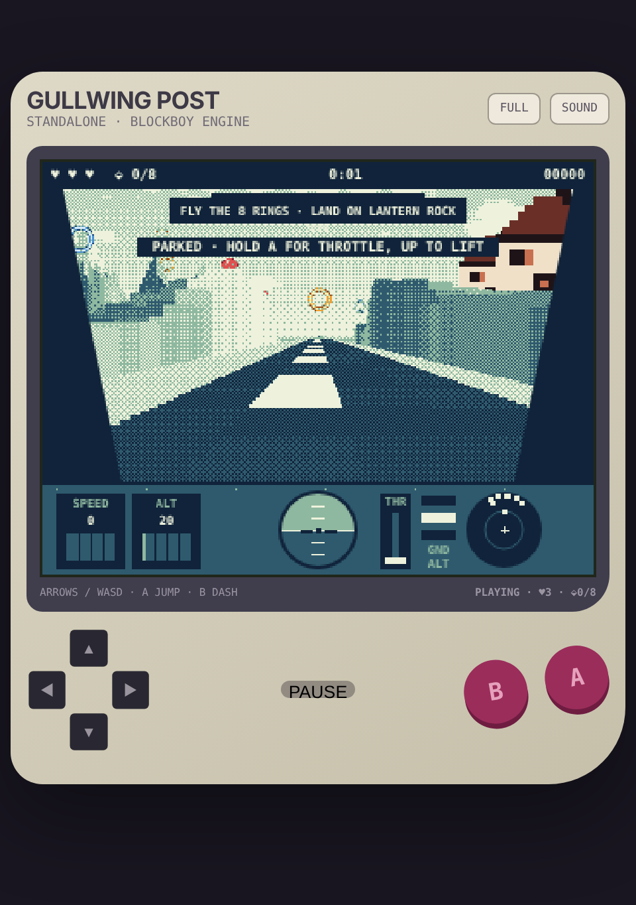

**Gullwing Post** is a first-person flight game. Wren flies the island mail over the Saltmarrow Isles: take off from Harbour Field on the home island, fly through the eight beacon rings of the mail route in any order, and land on the strip on top of Lantern Rock in the east. Lantern balloons are worth points. Hitting the ground anywhere but a runway costs a heart and restarts at the last checkpoint ring.

1. **Harbour Field (west):** Wren starts parked on the runway, facing east.
2. **The Teeth (north-west):** three snowy peaks. One ring threads the gap between them and one floats high above.
3. **Gannet Gorge (centre):** two long rock ridges with a channel between them. Two rings sit low inside it.
4. **Old Ember (north-east):** a volcano with a ring over its crater.
5. **The Patchwork (south):** a farm island with a mill pond. Two rings sit low over the fields and the sea.
6. **Lantern Rock (east):** a flat-topped cliff with the landing strip on top. It opens once all eight rings are in.

## Play it

- **In your browser:** download [`index.html`](index.html) and open it. The whole game is in that one file and needs no install or internet connection.
- **On the web:** turn on GitHub Pages for this repo (Settings > Pages > Deploy from branch `main`, folder `/`) and the game plays at `https://icakinser.github.io/blockboy-gullwing-post/`.
- **In BlockBoy:** download [`gullwing-post-cartridge.json`](gullwing-post-cartridge.json), then in the editor click **FILE > Open…** and **Browse this computer…** (or drop the file on the Open window) to see and edit every object, block and rule. The game also ships with BlockBoy itself under **FILE > New Game… > GULLWING POST**.

The controls are listed in [Controls in the finished game](#controls-in-the-finished-game) below.

## Screenshots

| | |
|---|---|
| 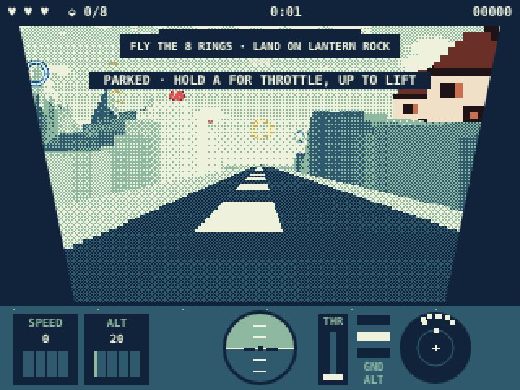 Parked on Harbour Field, ready for take-off | 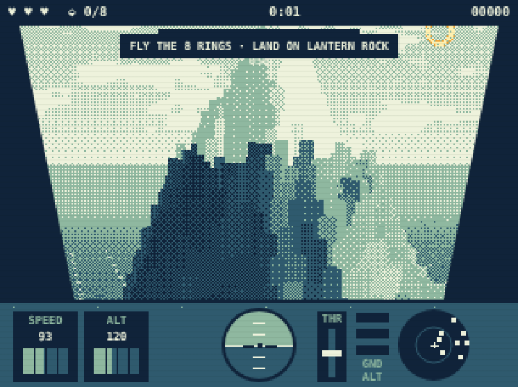 The Teeth |
| 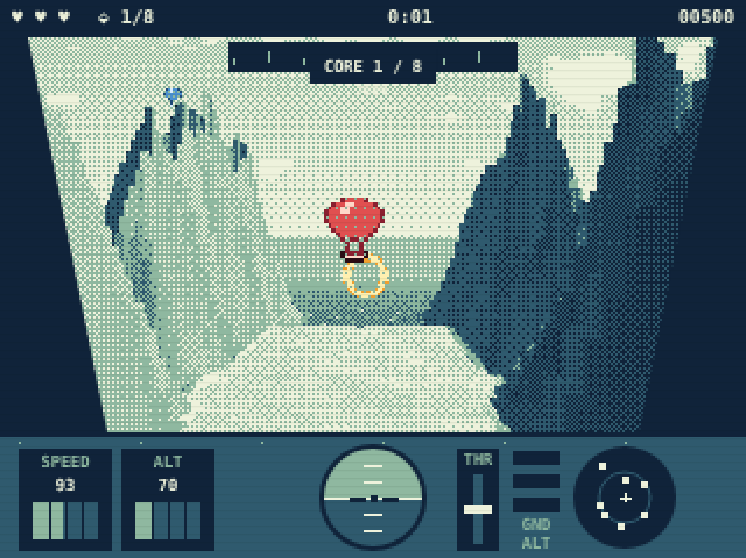 A ring and a lantern balloon in Gannet Gorge | 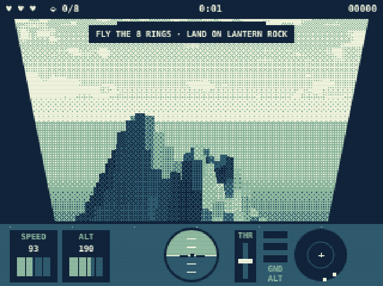 Old Ember, the volcano |
| 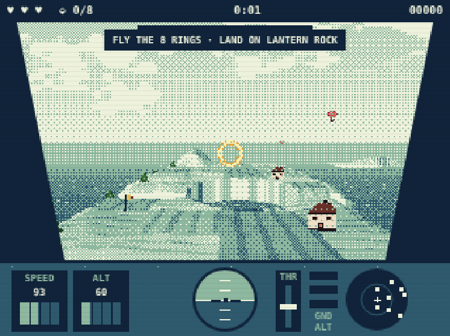 The Patchwork farm island | 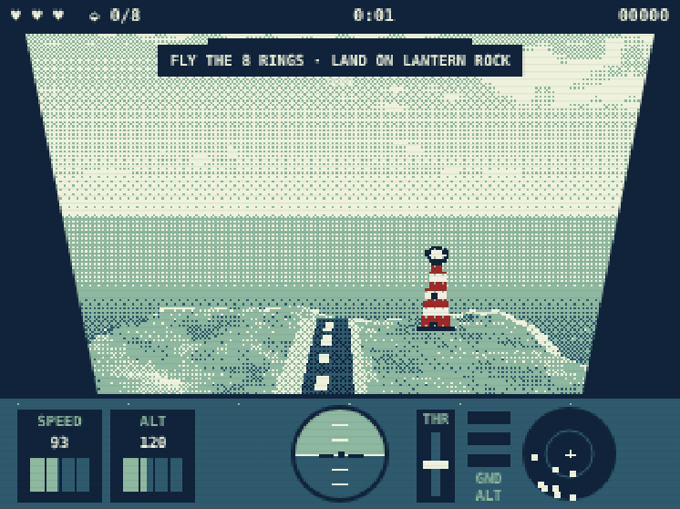 Lantern Rock and the landing strip |

## What's in this repo

| File | What it is |
| --- | --- |
| `index.html` | The standalone game, exported from BlockBoy |
| `gullwing-post-cartridge.json` | The game's cartridge, for loading into the BlockBoy editor |
| `screenshots/` | The gameplay pictures in this README |
| `EDITOR-BASICS.md` | Where to click in the BlockBoy editor, with annotated screenshots |
| `images/` | Editor screenshots used by the tutorial |
| `sprites/` | The game's pixel art as PNG files, ready to import |

## Tutorial: build Gullwing Post step by step

**Gullwing Post** is a first-person flight game. Wren flies the island mail over the Saltmarrow Isles: take off from Harbour Field on the home island, fly through the eight beacon rings of the mail route in any order, and land on the strip on top of Lantern Rock in the east. Lantern balloons are worth points. Hitting the ground anywhere but a runway costs a heart and restarts at the last checkpoint ring.

1. **Harbour Field (west):** Wren starts parked on the runway, facing east.
2. **The Teeth (north-west):** three snowy peaks. One ring threads the gap between them and one floats high above.
3. **Gannet Gorge (centre):** two long rock ridges with a channel between them. Two rings sit low inside it.
4. **Old Ember (north-east):** a volcano with a ring over its crater.
5. **The Patchwork (south):** a farm island with a mill pond. Two rings sit low over the fields and the sea.
6. **Lantern Rock (east):** a flat-topped cliff with the landing strip on top. It opens once all eight rings are in.

This tutorial rebuilds the whole game from an empty cartridge in the BlockBoy editor, object by object, with every block setting. Every step says exactly what to click, and every object has a picture of how it looks in the editor when it is done. The five flight blocks are covered in depth in [the block reference](https://github.com/icakinser/Blockboy-Game-Foundry/blob/main/docs/BLOCK-REFERENCE.md#flight).

**What you will learn:** how the cockpit view turns a top-down map into 3D land; a plane hero (bank, climb, throttle, stall, crash); hills, peaks, ridges, a volcano, mesas and a lake made from Landform objects; runways to take off from and land on; rings, balloons and checkpoints floating in the sky; a finish line that only counts once you have landed.

**Time:** about 2 hours.

---

### Before you start

#### Learn the editor moves

If you have not used the BlockBoy editor before, read **[BlockBoy editor basics](EDITOR-BASICS.md)** first (10 minutes). It shows, with pictures, where to click for everything this tutorial asks you to do. The steps below link to the right section each time.

The moves you will repeat most:

| The tutorial says                              | You do                                                                                                                                                                    |
| ---------------------------------------------- | ------------------------------------------------------------------------------------------------------------------------------------------------------------------------- |
| **Place a Spikes**                             | Toolbox > **OBJECTS** tab > click **Spikes** > click the map > click **DONE** ([§8](EDITOR-BASICS.md#8-place-an-object))                                                  |
| **Name Home island, at `120, 480, 320 × 240`** | In the inspector type the name, then X = 120, Y = 480, W = 320, H = 240 ([§9](EDITOR-BASICS.md#9-name-an-object-and-type-its-position-and-size))                          |
| **Remove Hazard**                              | Click the **×** on the Hazard card ([§10](EDITOR-BASICS.md#10-block-cards-turn-off-reorder-remove-and-change-settings))                                                   |
| **Add Landform (Collisions)**                  | **ADD COLLISION** > type "Landform" in the search box > click **Landform** ([§11](EDITOR-BASICS.md#11-add-a-block))                                                       |
| **`Height = 34`**                              | In that block's card, type 34 in the **Height** box, or pick the value from its list ([§10](EDITOR-BASICS.md#10-block-cards-turn-off-reorder-remove-and-change-settings)) |
| **Sprite `home-island/idle.png`**              | **SPRITE** > **IMPORT PNG / SHEET** > pick the file from this tutorial's `sprites` folder > **SAVE SPRITE** ([§15](EDITOR-BASICS.md#15-sprites-import-or-draw))           |
| **Copy it**                                    | Select the finished object, press **Ctrl+D** (**⌘D** on a Mac) to duplicate it, then type the copy's name, position and changed settings                                  |

"Actions" blocks are added with **ADD ACTION**, "Collisions" blocks with **ADD COLLISION**. Anything a step does not mention stays at its default.

#### Get the sprite files

The finished game's pixel art is in the [`sprites/gullwing-post`](sprites/gullwing-post) folder next to this tutorial, one folder per object and one PNG per animation. Download it (on GitHub: **Code > Download ZIP**, then unzip) so you can import the pictures instead of drawing them.

#### Keep the finished game open for comparison

Open a second BlockBoy window (or browser tab), click **BUILD**, then **FILE > New Game… > GULLWING POST**. Play it once with **PLAY**. Click any object to see its blocks, or press **/** and type its name.

Then, in your working window, start your own game (Part 1) and save it under its own name with **FILE > Save As…** ([§21](EDITOR-BASICS.md#21-save-your-work)). Save again after every part.

#### How the 3D works

You still build on the flat map, seen from above. The hero's spot on the map is the point under the plane; the plane's height is kept by **Flight controls**. When you press Play, **Cockpit view** draws the map as land:

- an object with **Landform** raises the ground under its rectangle (or flattens it into a lake);
- an object with **Runway** lays a flat landing strip;
- every other object with a sprite stands up on the ground facing you, or floats at its **Sky height**.

#### Coordinates and sizes

- Every object gives `x, y, w × h` (top-left corner and size). Map **y grows south**, so a small y is north. Heights (altitude, landform height) are in the same pixels as the map.
- One object can be at most one screen: `320 × 240`. Bigger islands are several landforms overlapping; where they overlap, the higher one wins.
- Scenery here is mostly **Spikes** with the **Hazard** block removed: an object with no blocks is just a picture.

#### Controls in the finished game

| Key            | Does                                             |
| -------------- | ------------------------------------------------ |
| Space or Z (A) | Open the throttle (faster)                       |
| X (B)          | Close the throttle; on the ground, brake         |
| Up             | Climb; on the runway above stall speed, lift off |
| Down           | Dive                                             |
| Left / Right   | Bank and turn; on the ground, steer              |

Up also counts as A on the keyboard, so the throttle only opens while Up is not held.

---

### Part 1: Set up the scene

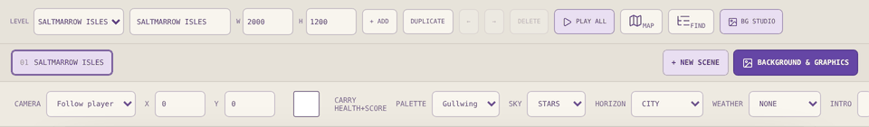

The picture shows the scene bar of the finished game. Make yours match.

#### 1.1 Start an empty game

1. Click **BUILD** (top of the screen).
2. Click **FILE > New Game…**, then **EMPTY GAME** ([§2](EDITOR-BASICS.md#2-start-a-new-game)).
3. Click the long ground strip along the bottom of the map and press **Delete** (or click the bin at the top of the inspector). A flight game has no floor.

#### 1.2 Name and size the scene

([§4](EDITOR-BASICS.md#4-name-and-size-a-scene), [§5](EDITOR-BASICS.md#5-scene-settings-camera-palette-sky-weather-and-intro))

1. Click the **scene name** box, select `UNTITLED CART` and type **SALTMARROW ISLES**.
2. **W** = **2000**, **H** = **1200** (the biggest a scene can be). Press **Tab**.
3. **CAMERA** = **Follow player**. The editor still scrolls the map; in play the cockpit takes over.
4. **INTRO** = `FLY THE 8 RINGS · LAND ON LANTERN ROCK`.

#### 1.3 Make the palette

([§7](EDITOR-BASICS.md#7-make-your-own-palette))

1. Click **SCENE STUDIO** (top right of the editor), then **MAKE OR EDIT PALETTES…**.
2. Under BUILT IN click **Classic**, then **COPY**.
3. **NAME** = **Gullwing**. Click each colour square and type the hex code:

   | Shade         | Gullwing  |
   | ------------- | --------- |
   | Ink (darkest) | `#10233a` |
   | Dark          | `#2f5a6e` |
   | Light         | `#8fb8a0` |
   | Paper         | `#eef2dc` |

4. Click **Gullwing** under YOUR PALETTES, then **USE FOR THIS LEVEL**. Close the window with **×** and click **DONE · EDIT SCENE MAP**. The 3D view uses these four shades for the land and sky, with dithering in between.

#### 1.4 The map, roughly

|                   | x 0 to 600          | x 600 to 1200       | x 1200 to 2000      |
| ----------------- | ------------------- | ------------------- | ------------------- |
| **y 0 to 450**    | open sea            | The Teeth           | Old Ember           |
| **y 450 to 850**  | Home island (start) | Gannet Gorge (west) | Gannet Gorge (east) |
| **y 850 to 1200** | open sea            | The Patchwork       | Lantern Rock (end)  |

To see a part of the map while you work, drag it with **Pan** (or hold **Space** and drag), use **ZOOM** in the toolbar, or select an object there with **FIND**.

---

### Part 2: Wren and her plane

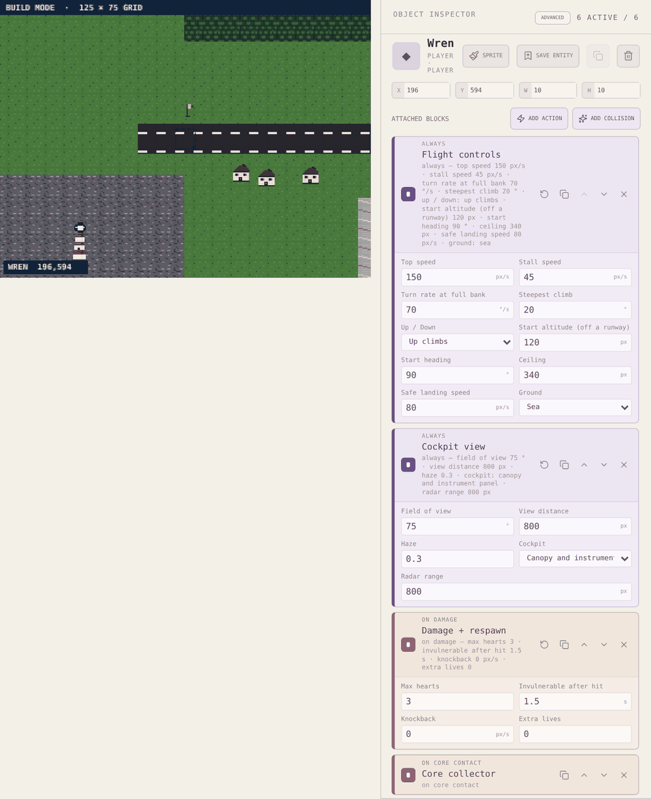

#### 2.1 Position and starter blocks

1. Click the hero. Name it **Wren**, at `196, 594, 10 × 10`. Small, so the plane fits through the rings.
2. Click **×** on **Gravity, Run, Jump, Double jump, Dash, Stomp attack, Dash attack** and **Heart collector**. Nothing should move the hero except the plane.

#### 2.2 Flight controls

1. **ADD ACTION** > search "Flight" > **Flight controls**. Click its **up arrow** until it is the first card.
2. Set every setting:

   | Setting                       | Value     |
   | ----------------------------- | --------- |
   | Top speed                     | 150       |
   | Stall speed                   | 45        |
   | Turn rate at full bank        | 70        |
   | Steepest climb                | 20        |
   | Up / Down                     | Up climbs |
   | Start altitude (off a runway) | 120       |
   | Start heading                 | 90 (east) |
   | Ceiling                       | 340       |
   | Safe landing speed            | 80        |
   | Ground                        | Sea       |

   **Ground = Sea** makes everything outside the islands water. A hero placed on a Runway starts parked on it; anywhere else it starts in the air at the start altitude.

#### 2.3 Cockpit view

1. **ADD ACTION** > search "Cockpit" > **Cockpit view**.
2. Set `Field of view = 75`, `View distance = 800`, `Haze = 0.3`, `Cockpit = Canopy and instrument panel`, `Radar range = 800`.

#### 2.4 The rest

1. **Damage + respawn**: `Max hearts = 3`, `Invulnerable after hit = 1.5`, `Knockback = 0`.
2. Keep **Core collector, Exit reader, Checkpoint reader**.
3. **SPRITE** > import `sprites/gullwing-post/wren/idle.png` (a small plane seen from above) > **SAVE SPRITE**. You only see it on the editor map; in play you are inside it.

> **Check:** click **PLAY**. You should see the sea all the way to the horizon, a cockpit panel, and the compass reading 090. With no runway yet, Wren starts in the air: try banking and climbing. Hitting the sea is a crash, so climb before you try anything else. Press **E** to come back.

---

### Part 3: The home island and Harbour Field

Every landform is a **Spikes** object with **Hazard removed** and **Landform** added. Landforms are not drawn in 3D as objects (the land is), but they show on the editor map, so each gets a tiled sprite that says what it is:

| Sprite file               | Look                     | Used for                     |
| ------------------------- | ------------------------ | ---------------------------- |
| `home-island/idle.png`    | green turf               | grass hills                  |
| `gull-head/idle.png`      | grey stone               | rock                         |
| `north-tooth/idle.png`    | stone with snow          | snowy peaks                  |
| `home-beach/idle.png`     | sand dunes               | beaches, slopes, gorge floor |
| `patchwork-west/idle.png` | furrows                  | fields                       |
| `harbour-woods/idle.png`  | dark green canopy        | forest                       |
| `mill-pond/idle.png`      | waves                    | lakes                        |
| `harbour-field/idle.png`  | tarmac with a white dash | runways                      |

Always set **ON BIG OBJECTS = Repeat as tiles** for these.

#### 3.1 The first landform: Home island

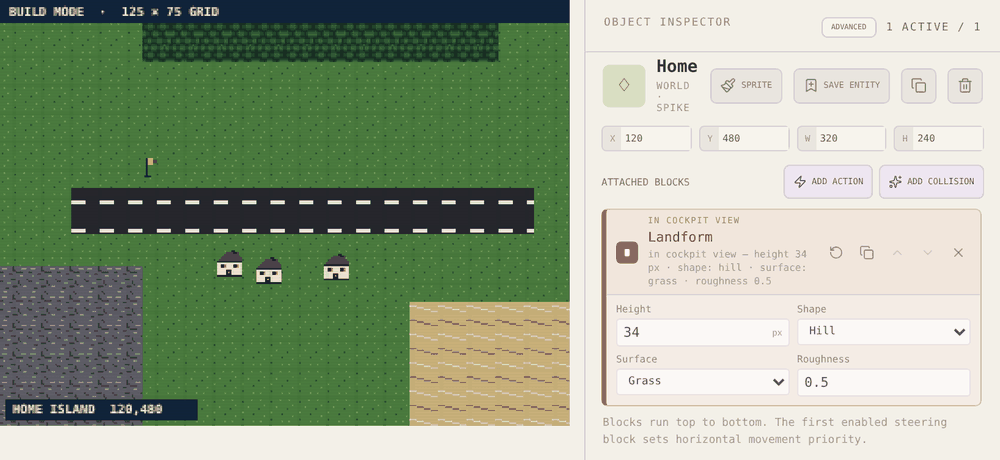

1. Place a **Spikes**. Name it **Home island**, at `120, 480, 320 × 240`.
2. Click **×** on **Hazard**.
3. **ADD COLLISION** > search "Landform" > **Landform**. Set `Height = 34`, `Shape = Hill`, `Surface = Grass`, `Roughness = 0.5`.
4. **SPRITE** > import `home-island/idle.png`, **ON BIG OBJECTS = Repeat as tiles** > **SAVE SPRITE**.

#### 3.2 The rest of the home island

For each row: select the closest finished landform, press **Ctrl+D**, type the name and `x, y, w × h`, set the Landform settings, and if the look changes, re-import the sprite from the table above.

| Name             | x, y, w × h          | Height | Shape           | Surface | Roughness | Sprite          |
| ---------------- | -------------------- | ------ | --------------- | ------- | --------- | --------------- |
| Home island west | `40, 400, 200 × 240` | 46     | Hill            | Grass   | 0.5       | `home-island`   |
| Gull Head        | `40, 630, 160 × 140` | 80     | Hill            | Rock    | 0.6       | `gull-head`     |
| Harbour woods    | `200, 425, 200 × 90` | 24     | Mesa (flat top) | Forest  | 0.2       | `harbour-woods` |
| Home beach       | `350, 650, 140 × 80` | 6      | Mesa (flat top) | Sand    | 0.1       | `home-beach`    |

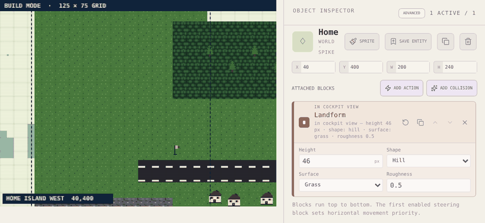

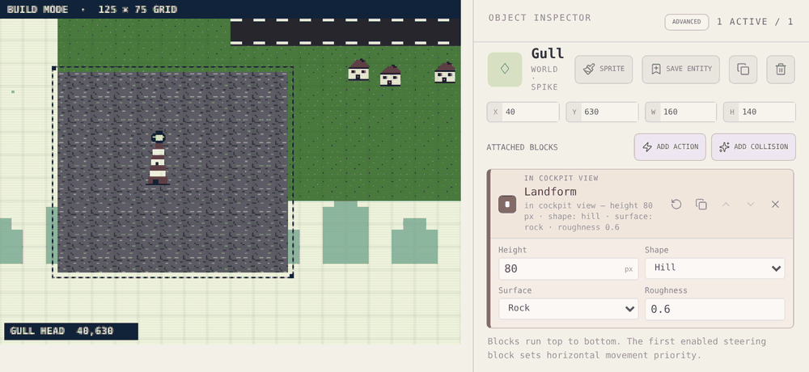

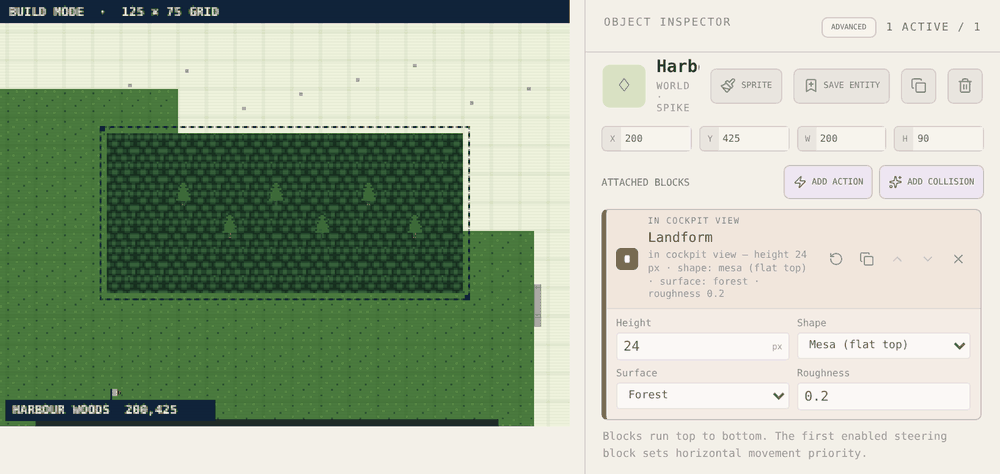

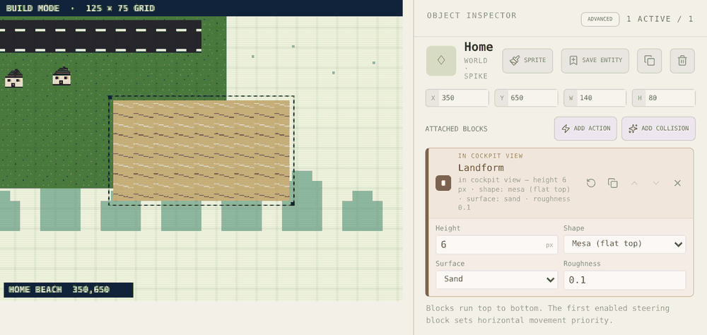

#### 3.3 Harbour Field (the runway)

Place it after the island so the runway flattens the hill under it.

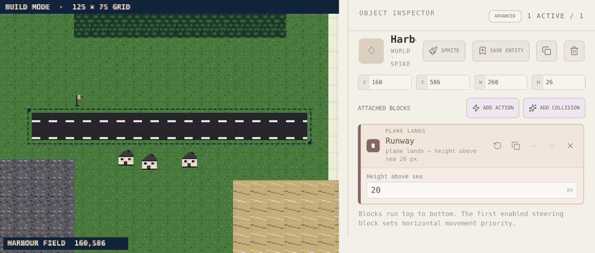

1. Place a **Spikes**. Name **Harbour Field**, at `160, 586, 260 × 26`.
2. **×** on **Hazard**.
3. **ADD COLLISION** > search "Runway" > **Runway**: `Height above sea = 20`. The centre line runs along the longer side, east-west.
4. **SPRITE** > import `harbour-field/idle.png`, **Repeat as tiles** > **SAVE SPRITE**.

Wren at `196, 594` now sits on the runway, so she starts parked.

#### 3.4 Scenery

Scenery objects are **Spikes** with **Hazard** removed and a sprite, nothing else. They stand up in 3D, as tall as they are wide.

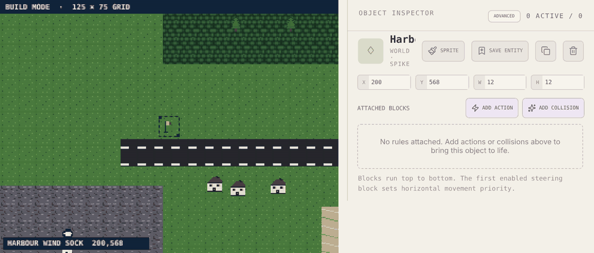

1. Place a **Spikes**. Name **Harbour wind sock**, at `200, 568, 12 × 12`. **×** on **Hazard**. **SPRITE** > import `harbour-wind-sock/idle.png` > **SAVE SPRITE**.

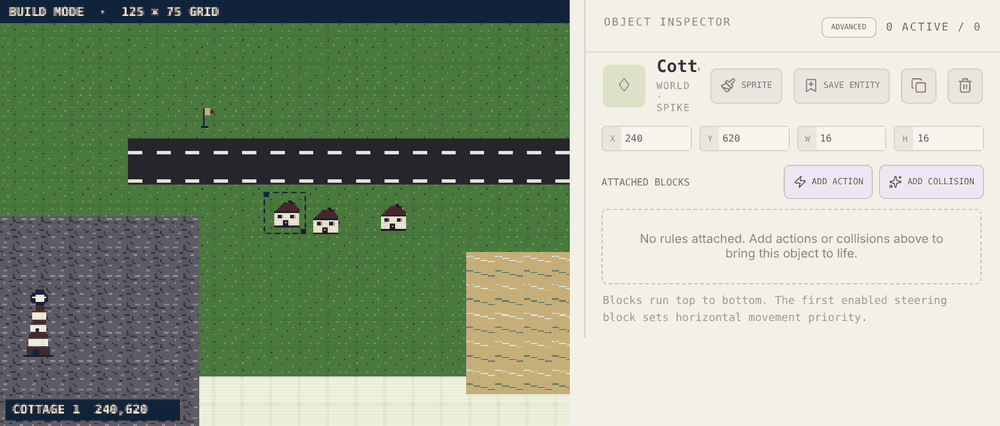

2. **Ctrl+D** on the wind sock. Name **Cottage 1**, at `240, 620, 16 × 16`, and import `cottage-1/idle.png` as its sprite. Then **Ctrl+D** for **Cottage 2** at `262, 624` and **Cottage 3** at `300, 622`.

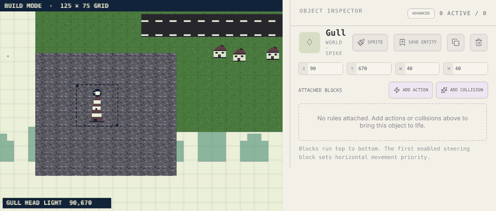

3. **Ctrl+D** on a cottage. Name **Gull Head light**, at `90, 670, 40 × 40`. Open **SPRITE**, set **SIZE = 32 × 32**, import `gull-head-light/idle.png` (two frames: lamp lit, lamp dim), **FRAME TIME = 0.6** > **SAVE SPRITE**. It blinks.

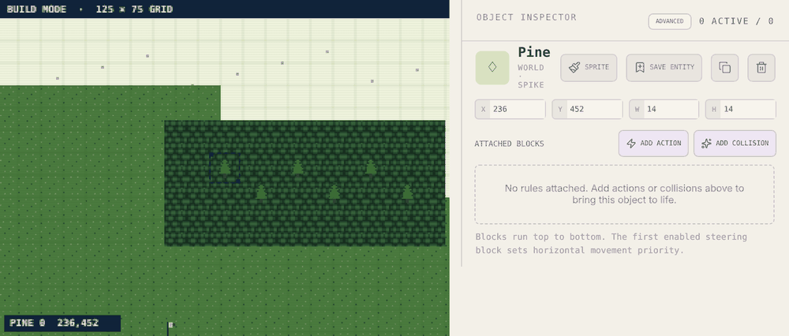

4. **Ctrl+D** on a cottage. Name **Pine 0**, at `236, 452, 14 × 14`, sprite `pine-0/idle.png`. Then **Ctrl+D** for the rest of the woods, all `14 × 14`:

   | Name   | x, y     |
   | ------ | -------- |
   | Pine 1 | 262, 470 |
   | Pine 2 | 288, 452 |
   | Pine 3 | 314, 470 |
   | Pine 4 | 340, 452 |
   | Pine 5 | 366, 470 |

> **Check:** play. Hold **Space** until the speed passes 45, then hold **Up**. "AIRBORNE" means you are flying. Bank around and look back at the island: the woods, cottages and lighthouse should stand on the land.

---

### Part 4: The Teeth

Peaks with surface **Rock, snow on top** get white caps above about 60% of their height. A wide low hill underneath makes foothills. Copy a landform for each row (**Ctrl+D**) and type the values:

| Name            | x, y, w × h           | Height | Shape | Surface           | Roughness | Sprite        |
| --------------- | --------------------- | ------ | ----- | ----------------- | --------- | ------------- |
| North Tooth     | `650, 130, 220 × 220` | 210    | Peak  | Rock, snow on top | 0.5       | `north-tooth` |
| Crooked Tooth   | `820, 280, 200 × 200` | 170    | Peak  | Rock, snow on top | 0.6       | `north-tooth` |
| Little Tooth    | `560, 320, 160 × 160` | 110    | Peak  | Rock              | 0.5       | `gull-head`   |
| Teeth foothills | `620, 210, 320 × 240` | 40     | Hill  | Grass             | 0.6       | `home-island` |

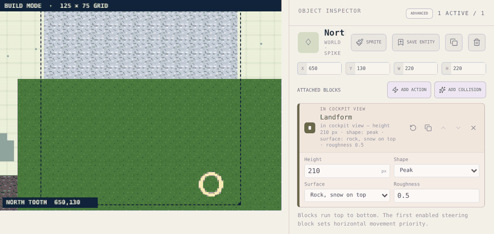

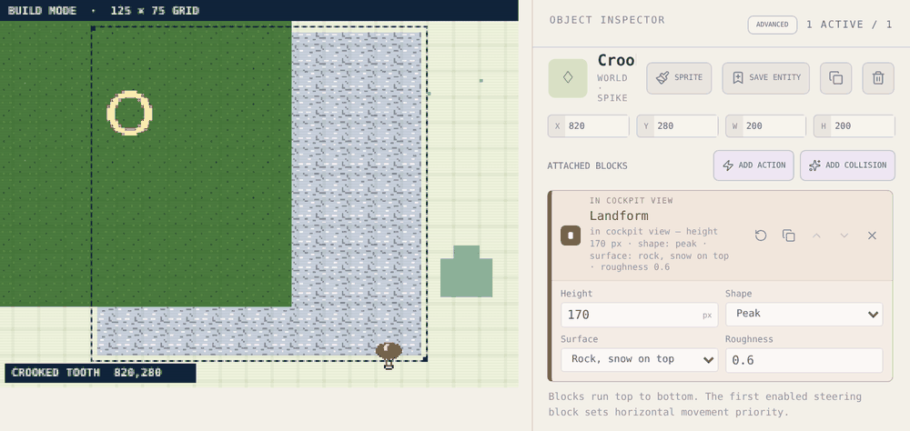

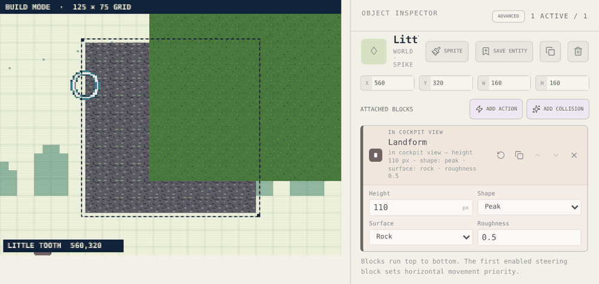

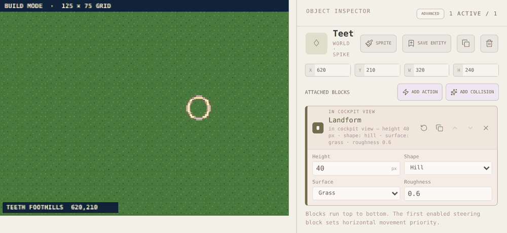

The order of overlapping landforms does not matter: at every point the highest one wins.

---

### Part 5: Gannet Gorge

Two **Ridge** landforms side by side make a gorge. A ridge runs along the longer side of its rectangle, so these wide, thin rectangles make east-west walls. Each wall is two pieces because one object can be at most 320 wide.

| Name                  | x, y, w × h            | Height | Shape           | Surface | Roughness | Sprite       |
| --------------------- | ---------------------- | ------ | --------------- | ------- | --------- | ------------ |
| Gorge north wall      | `990, 555, 320 × 90`   | 140    | Ridge           | Rock    | 0.5       | `gull-head`  |
| Gorge north wall east | `1280, 545, 280 × 90`  | 150    | Ridge           | Rock    | 0.5       | `gull-head`  |
| Gorge south wall      | `1000, 725, 320 × 90`  | 130    | Ridge           | Rock    | 0.5       | `gull-head`  |
| Gorge south wall east | `1290, 735, 280 × 90`  | 140    | Ridge           | Rock    | 0.5       | `gull-head`  |
| Gorge floor           | `1130, 610, 320 × 160` | 14     | Mesa (flat top) | Sand    | 0.2       | `home-beach` |

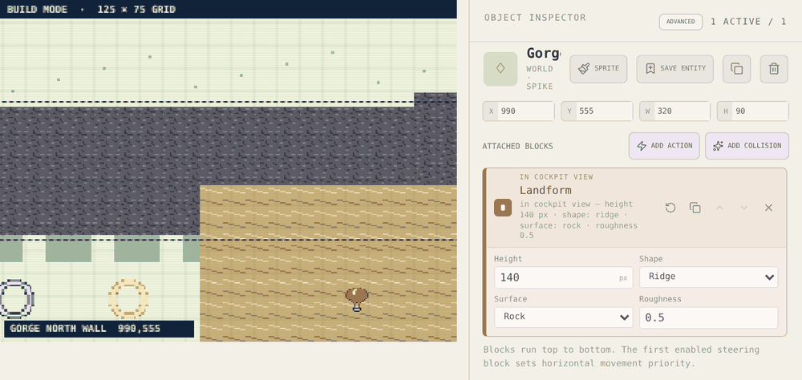

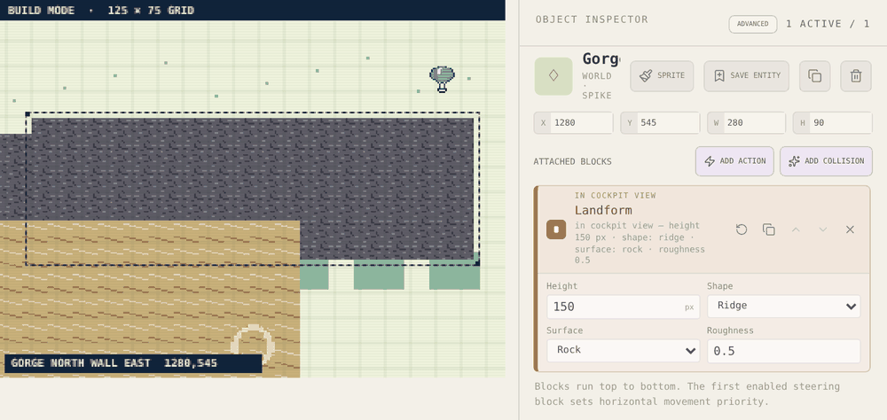

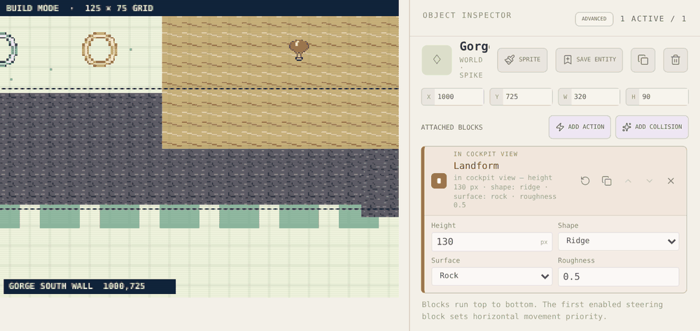

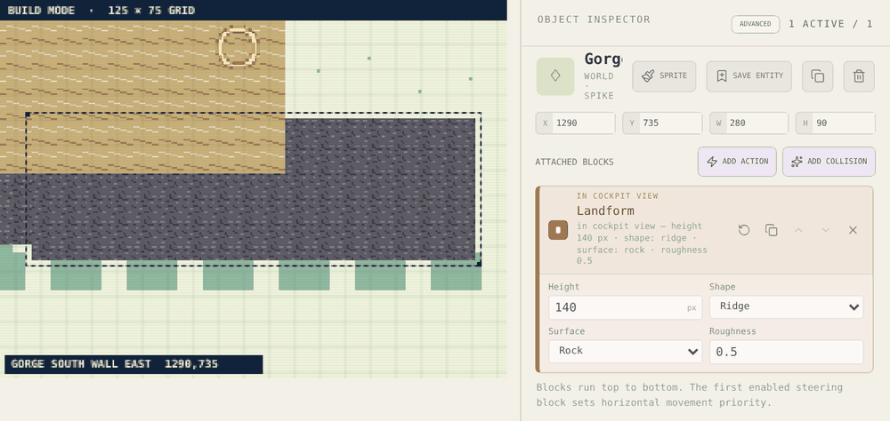

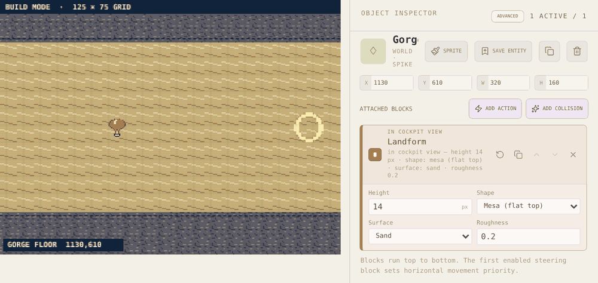

The channel between the walls is about 80 px wide at the bottom. Fly through it at 50 to 70 altitude.

---

### Part 6: Old Ember

| Name         | x, y, w × h            | Height | Shape   | Surface | Roughness | Sprite       |
| ------------ | ---------------------- | ------ | ------- | ------- | --------- | ------------ |
| Old Ember    | `1530, 160, 260 × 240` | 240    | Volcano | Rock    | 0.4       | `gull-head`  |
| Ember slopes | `1500, 180, 320 × 240` | 50     | Hill    | Sand    | 0.5       | `home-beach` |

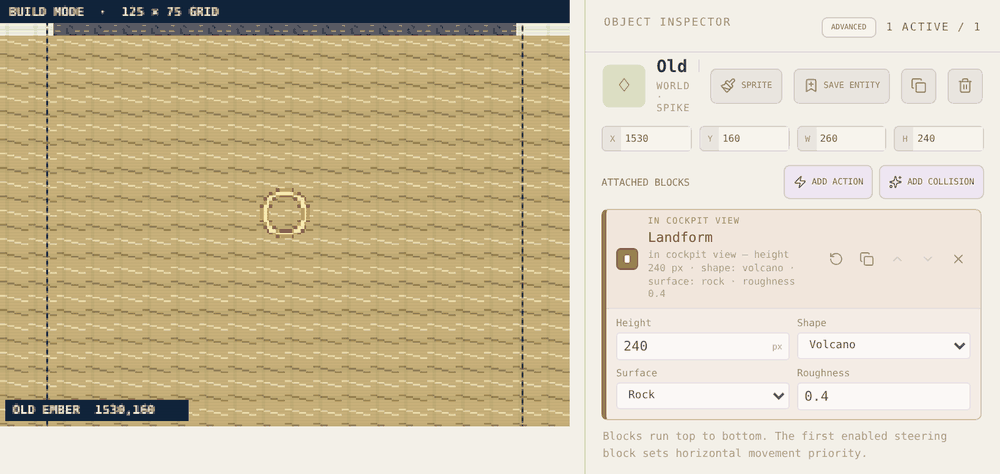

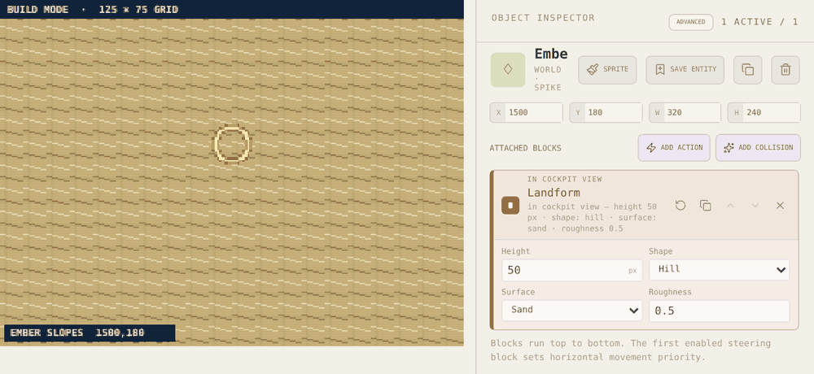

A **Volcano** is a cone with a crater: the top 20% of the middle drops down, so a ring floating just above the rim sits over a hole.

---

### Part 7: The Patchwork

| Name            | x, y, w × h            | Height | Shape                    | Surface | Roughness | Sprite           |
| --------------- | ---------------------- | ------ | ------------------------ | ------- | --------- | ---------------- |
| Patchwork west  | `610, 890, 300 × 220`  | 22     | Mesa (flat top)          | Fields  | 0.2       | `patchwork-west` |
| Patchwork east  | `900, 910, 280 × 200`  | 18     | Mesa (flat top)          | Fields  | 0.2       | `patchwork-west` |
| Mill Pond       | `840, 945, 120 × 90`   | 0      | Lake (flattens to water) | Water   | 0.4       | `mill-pond`      |
| Patchwork downs | `560, 1000, 160 × 120` | 50     | Hill                     | Grass   | 0.5       | `home-island`    |

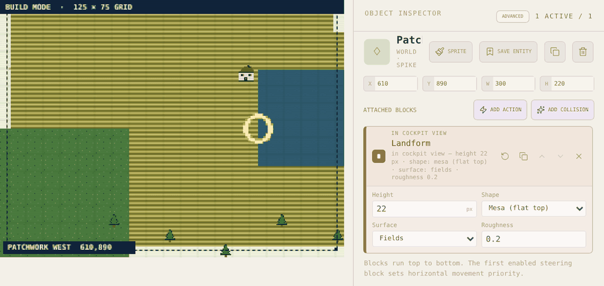

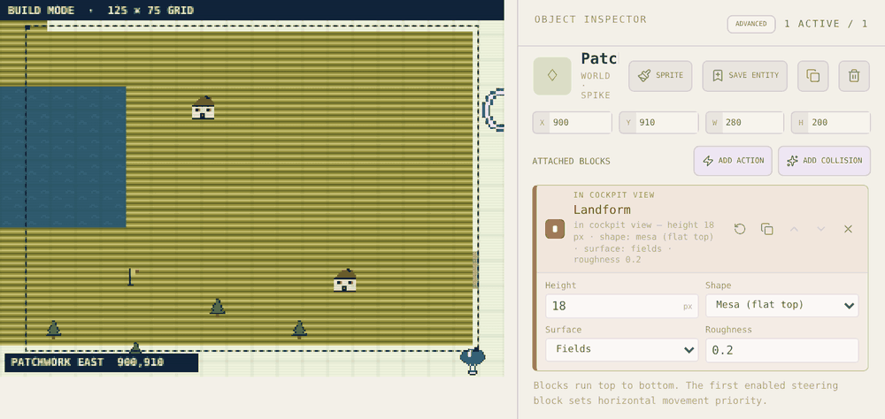

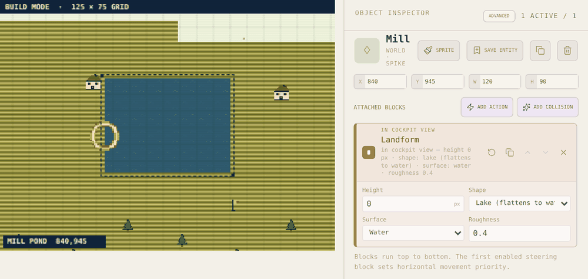

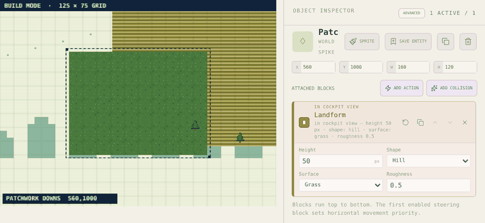

A **Lake** flattens everything under its oval to water at sea level, whatever order you place it in.

Scenery (copy the Part 3 scenery with **Ctrl+D**):

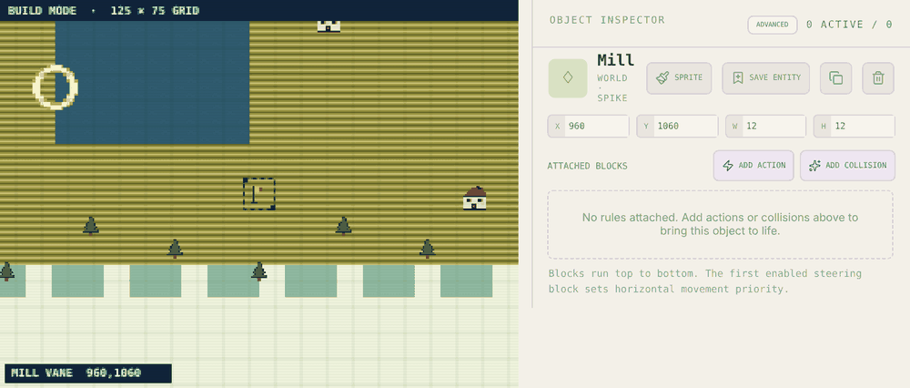

1. Copy **Harbour wind sock**: **Mill vane** at `960, 1060`.
2. Copy a cottage: **Cottage 4** at `820, 940`, **Cottage 5** at `1000, 950`, **Cottage 6** at `1090, 1060`.
3. Copy a pine, and change W and H to `12 × 12`, for a row along the south shore:

   | Name    | x, y       |
   | ------- | ---------- |
   | Pine 10 | 700, 1080  |
   | Pine 11 | 752, 1094  |
   | Pine 12 | 804, 1108  |
   | Pine 13 | 856, 1080  |
   | Pine 14 | 908, 1094  |
   | Pine 15 | 960, 1108  |
   | Pine 16 | 1012, 1080 |
   | Pine 17 | 1064, 1094 |

---

### Part 8: Lantern Rock and the landing strip

| Name           | x, y, w × h            | Height | Shape           | Surface | Roughness | Sprite        |
| -------------- | ---------------------- | ------ | --------------- | ------- | --------- | ------------- |
| Lantern Rock   | `1690, 850, 280 × 220` | 70     | Mesa (flat top) | Grass   | 0.15      | `home-island` |
| Lantern skirts | `1670, 840, 320 × 240` | 30     | Hill            | Rock    | 0.6       | `gull-head`   |

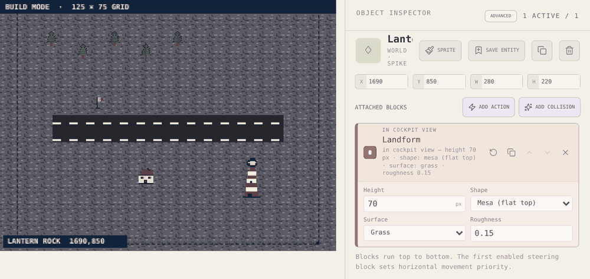

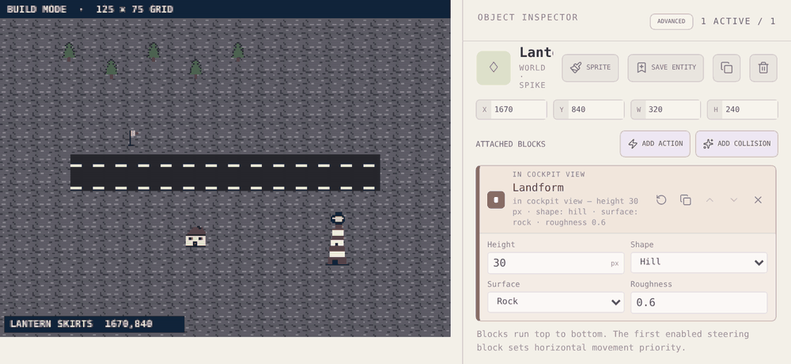

#### The Lantern strip (the finish)

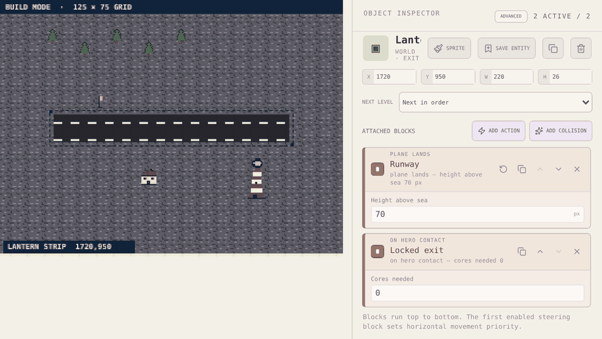

1. Place an **Exit**. Name **Lantern strip**, at `1720, 950, 220 × 26`.
2. Keep **Locked exit** with `Cores needed = 0`, which means all of them.
3. **ADD COLLISION** > **Runway**: `Height above sea = 70`, the same as the mesa top, so the strip is level with the cliff. Click its **up arrow** once so it sits above Locked exit, as in the finished game.
4. **SPRITE** > import `harbour-field/idle.png` (tarmac), **Repeat as tiles** > **SAVE SPRITE**.

While flying, the hero only touches an object at that object's own height. A runway is flat on the ground, so the Locked exit only counts once the plane has landed on it. Flying low over the strip does nothing.

#### Lantern Rock scenery

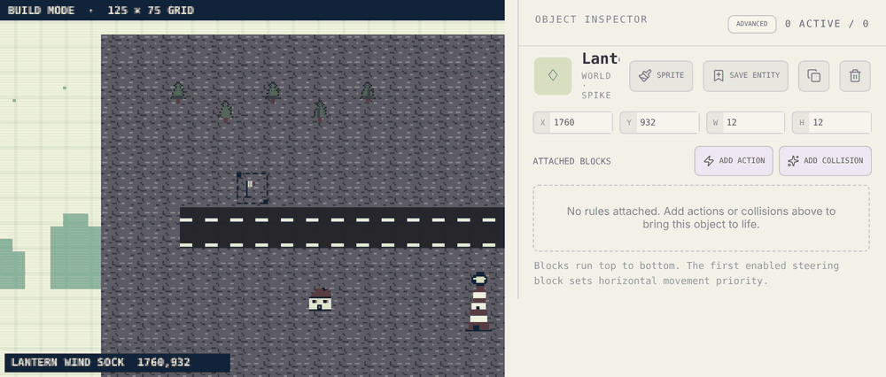

1. Copy **Harbour wind sock**: **Lantern wind sock** at `1760, 932`.

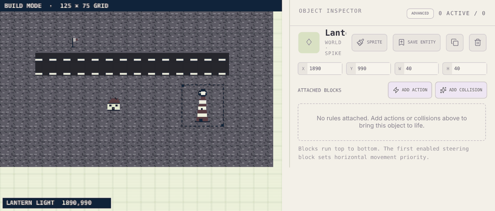

2. Copy **Gull Head light**: **Lantern light** at `1890, 990`.
3. Copy a cottage: **Cottage 7** at `1800, 1000`.
4. Copy **Pine 0** (`14 × 14`) for five pines on the clifftop:

   | Name    | x, y      |
   | ------- | --------- |
   | Pine 30 | 1712, 870 |
   | Pine 31 | 1742, 882 |
   | Pine 32 | 1772, 870 |
   | Pine 33 | 1802, 882 |
   | Pine 34 | 1832, 870 |

---

### Part 9: The eight rings

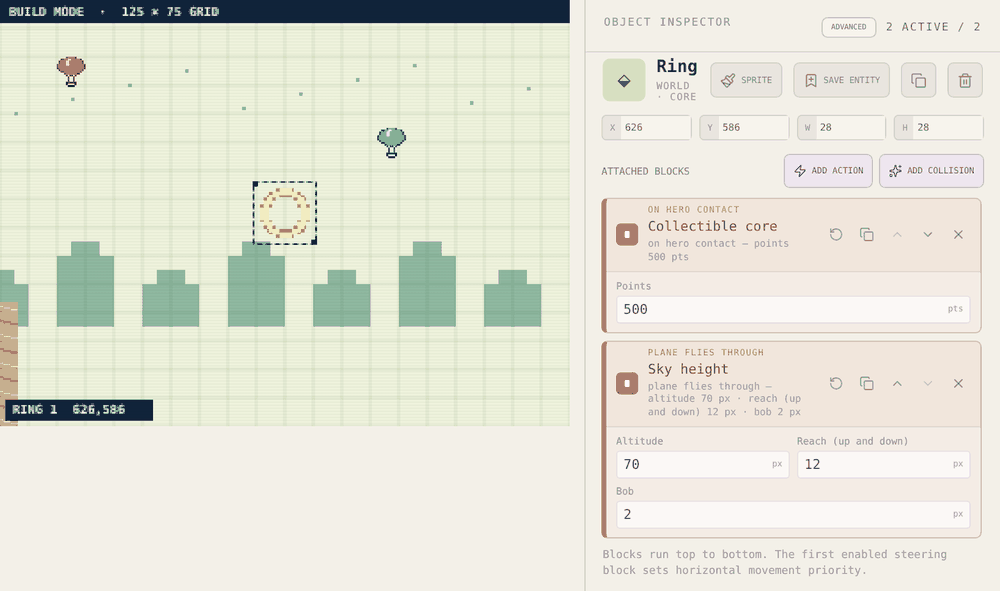

#### 9.1 The first ring

1. Place a **Core**. Name **Ring 1**, at `626, 586, 28 × 28`.
2. On its **Collectible core** card set `Points = 500`.
3. **ADD COLLISION** > search "Sky" > **Sky height**: `Altitude = 70`, `Reach (up and down) = 12`, `Bob = 2`.
4. **SPRITE** > import `ring-1/idle.png` (a hoop with a second, brighter frame), **FRAME TIME = 0.3** > **SAVE SPRITE**.

The plane collects a ring only when it crosses the ring on the map **and** is within Reach (12 px) of its altitude, so you have to fly through it, not over it.

#### 9.2 The other seven

**Ctrl+D** on Ring 1 for each, typing the name, x, y and the Sky height **Altitude**:

| Name   | x, y         | Altitude | Where                     |
| ------ | ------------ | -------- | ------------------------- |
| Ring 2 | `826, 316`   | 150      | the gap between the Teeth |
| Ring 3 | `986, 236`   | 250      | high over the Teeth       |
| Ring 4 | `1066, 676`  | 60       | gorge entrance            |
| Ring 5 | `1406, 676`  | 50       | deep in the gorge         |
| Ring 6 | `1646, 266`  | 280      | over Old Ember's crater   |
| Ring 7 | `1346, 1006` | 40       | low over the sea, south   |
| Ring 8 | `826, 986`   | 50       | over the Patchwork fields |

The radar on the panel shows rings as blinking dots, turned so straight ahead is up. A dot on the radar's edge is further away than the radar range.

---

### Part 10: Checkpoint rings

After a crash, Wren restarts at the last checkpoint ring she flew through, in the air, facing the way she was flying.

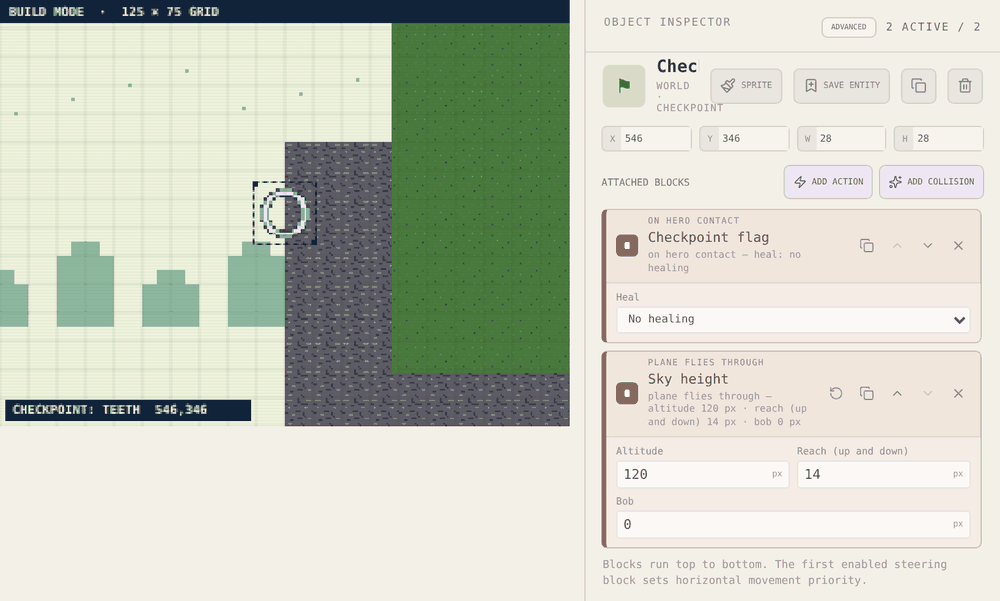

1. Place a **Checkpoint**. Name **Checkpoint: Teeth**, at `546, 346, 28 × 28`. Keep **Checkpoint flag**.
2. **ADD COLLISION** > **Sky height**: `Altitude = 120`, `Reach (up and down) = 14`, `Bob = 0`.
3. **SPRITE** > import `checkpoint-teeth/idle.png` (a plain blue ring, so it looks different from the beacon rings) > **SAVE SPRITE**.
4. **Ctrl+D** for the other two:

   | Name                  | x, y        | Altitude |
   | --------------------- | ----------- | -------- |
   | Checkpoint: Gorge     | `986, 676`  | 90       |
   | Checkpoint: Patchwork | `1186, 946` | 80       |

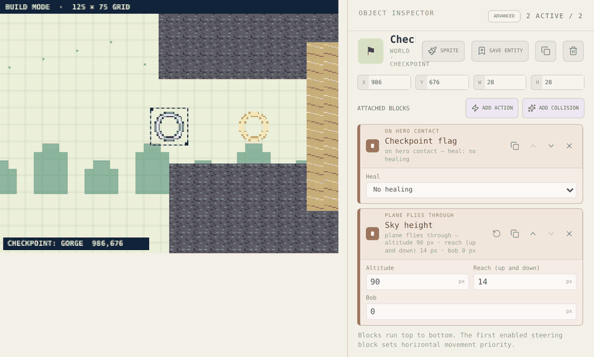

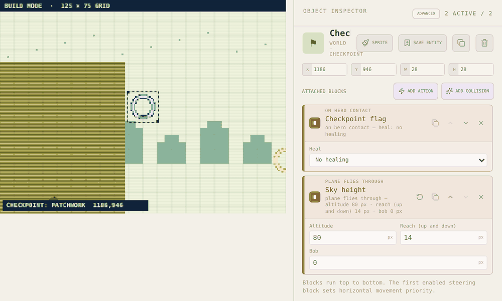

---

### Part 11: Lantern balloons

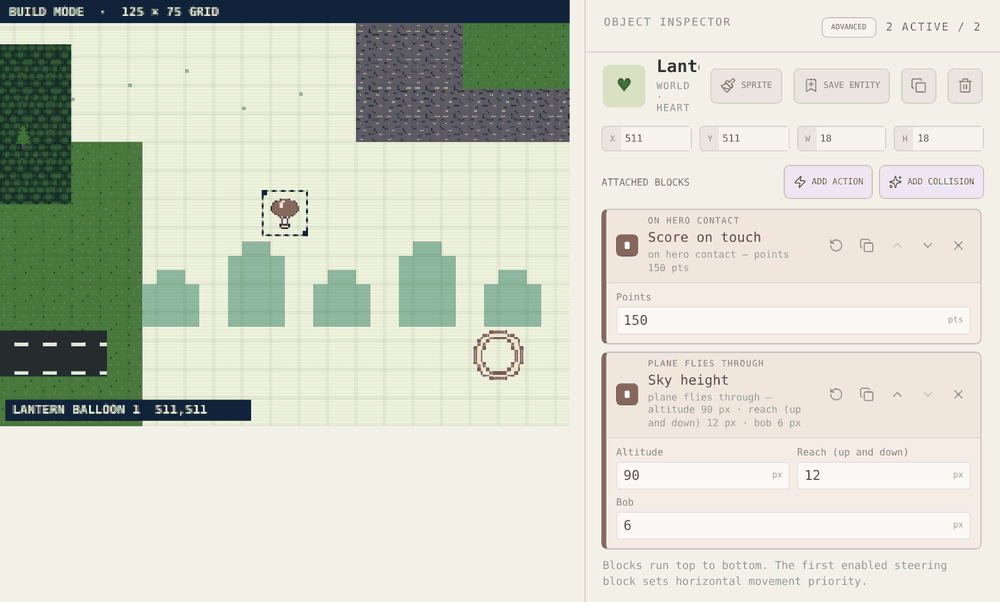

1. Place a **Heart**. Name **Lantern balloon 1**, at `511, 511, 18 × 18`.
2. **×** on **Healing heart**.
3. **ADD COLLISION** > search "Score" > **Score on touch**: `Points = 150`.
4. **ADD COLLISION** > **Sky height**: `Altitude = 90`, `Reach (up and down) = 12`, `Bob = 6`.
5. **SPRITE** > import `lantern-balloon-1/idle.png` (a balloon with a basket) > **SAVE SPRITE**.
6. **Ctrl+D** for the other nine, typing name, x, y and **Altitude**. Balloons 2, 5 and 8 are blue: re-import their sprite from `lantern-balloon-2/idle.png`.

   | Name               | x, y         | Altitude |
   | ------------------ | ------------ | -------- |
   | Lantern balloon 2  | `691, 551`   | 140      |
   | Lantern balloon 3  | `991, 471`   | 120      |
   | Lantern balloon 4  | `1231, 681`  | 70       |
   | Lantern balloon 5  | `1531, 511`  | 200      |
   | Lantern balloon 6  | `1791, 511`  | 160      |
   | Lantern balloon 7  | `1551, 931`  | 90       |
   | Lantern balloon 8  | `1171, 1111` | 60       |
   | Lantern balloon 9  | `691, 831`   | 100      |
   | Lantern balloon 10 | `391, 851`   | 60       |

---

### Part 12: Playtest the whole game

1. Hold **Space** to about 60 speed, then **Up** to lift off. Level out at about 70 and fly east through Ring 1.
2. Bank left (north) toward the Teeth. Fly through the blue checkpoint ring, then thread the gap for Ring 2 at 150. Climb to 250 for Ring 3 above the peaks.
3. Turn south-east to the gorge. Come down to 90 for the checkpoint, then 60 and 50 for Rings 4 and 5 between the walls. Climb out before the end.
4. Turn north to Old Ember and climb to 280 for Ring 6 over the crater.
5. Head south-west, drop low over the sea for Ring 7 at 40, through the Patchwork checkpoint, and Ring 8 over the fields.
6. Fly east to Lantern Rock. Line up with the strip from the west, close the throttle with **X** until the speed is under 80, and let the nose drift down. Keep the wings level. "TOUCHDOWN" then the win screen.

Watch the panel: **SPEED** and **ALT** gauges on the left, the artificial horizon in the middle (it banks and pitches with you), the throttle lever, three warning lamps (pull up, landed, too slow) and the radar. "PULL UP" blinks when you are close to the ground and sinking.

Save with **FILE > Save** when it works.

#### Troubleshooting

| Problem                                   | Fix                                                                                                    |
| ----------------------------------------- | ------------------------------------------------------------------------------------------------------ |
| The game shows the flat map, not 3D       | Wren needs **Cockpit view**                                                                            |
| Wren falls or walks instead of flying     | Remove Gravity, Run and Jump from Wren                                                                 |
| Wren starts in the air, not on the runway | Her rectangle's middle must be on the Runway object                                                    |
| Space does nothing while Up is held       | Up counts as A too, so the throttle only opens without Up. Let go of Up, open the throttle, then climb |
| A ring is not collected                   | Fly through its middle at its altitude (the panel's ALT within its Reach)                              |
| Flying over a tree or house crashes       | Only the ground crashes the plane; touching scenery does nothing unless it has blocks                  |
| Landing always crashes                    | Slower than Safe landing speed, wings level, a gentle descent, and on the Runway itself                |
| The exit does nothing on landing          | All eight rings first; check they are Core objects with Collectible core                               |
| A landform will not get bigger            | One object is at most 320 × 240: overlap two                                                           |
| Landforms look stretched on the map       | Their sprite needs **ON BIG OBJECTS = Repeat as tiles**                                                |
| The game runs slowly                      | Lower View distance in Cockpit view                                                                    |

---

### Ideas to take it further

- A **Time limit** turns it into an air race: add **Time limit** to the hero and a `coreBonus` so each ring buys more time.
- Swap **Ground = Desert** and use Mesa landforms in Sand and Rock for a canyon run.
- Set **Cockpit = Heads-up display only** for a cleaner arcade look, or **None** for a bare view.
- Give **Cockpit view** to a top-down hero with **Top-down move** and no Flight controls: you walk through the map at eye level, which makes a first-person maze.
- Put a **Sky height** on a **Wave spawner**'s spawns or on moving objects with **Patrol path** to make targets that drift through the sky.

